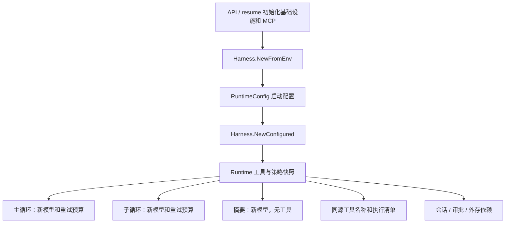
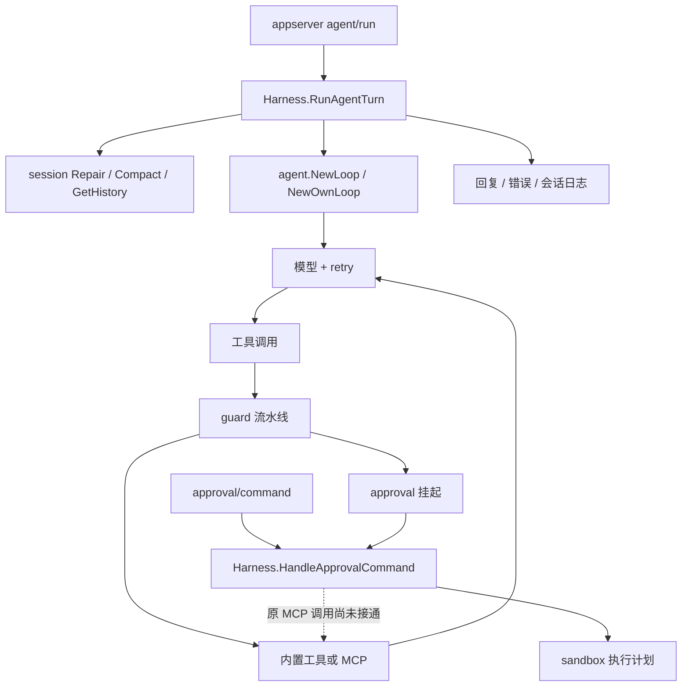

# 03：框架主干在哪里，哪些地方还没接上？

2026-09-17，代码基线 `fb4a996`。本页描述当前代码和下一步建设方向，不新增协作规则，也不表示用户已掌握。工程顺序见 `HARNESS-TODO.md` 的 F 系列。

## F-1 统一装配更新（运行待验）

Go 里需要分清“共享工厂”和“共享对象”：Runtime 保存造模型的函数，每次调用产生独立模型，防止绑定工具和重试额度串轮。主任务与子任务使用同一个 Runtime 的配置，但不共用可变模型实例。子任务工厂调用前就带嵌套标记，因此不读写父轮次的重试记录；独立子任务日志仍未实现。

扩展工具通过 `RuntimeConfig.ExtraTools` 注入，提示词名称由同一份注册表产生，无需单独维护名字。`Sessions` 同时提供会话操作和批量事件写入，避免主历史写一个库、工具事件写另一个库。外存与审批也沿同一份实例依赖传递。

API/resume 已改用此路径，静态检查通过，4 个新增用例及重建启动待验。旧 New/NewLoop 仍兼容，Redis 客户端和 hooks/metrics/tokenmeter 仍有进程级状态。下面是 `fb4a996` 基线问题记录，不能再当作新入口的实际路径。

## 基线请求路径

模型循环、工具回填、上下文投影与错误返回已有主干；上述压缩和取消修复是保护这条主干。框架尚缺的是装配可替换、通用审批接回工具执行，以及对外运行控制。

## 接口存在，不等于已经可以替换

`internal/harness/harness.go` 的 `Harness` 持有 `session.Store`、`approval.Store`、`sandbox.Executor`，这是已有的好基础。但同一条业务路径还会在其他位置直接取具体实现：

| 代码入口 | 当前连接 | 框架建设点 |
|---|---|---|
| `Harness.runLoop` | 直接调用 `agent.NewLoop` | 构造时指定循环/模型依赖，便于独立测试和扩展 |
| `agent.newChatModel` / `Summarize` | 直接读取环境并创建模型 | 把默认配置与运行逻辑分开，明确摘要是否使用同一模型依赖 |
| `agent.builtinTools` / `toolPipeline` | 固定内置清单、全局流水线，附加 MCP 工具 | 工具集合从实例装配；避免不同实例共享可变配置 |
| `agent.guardAskHandler` | 直接创建 approval.RedisStore，只保存截断参数 | 复用注入的审批依赖；完整执行数据不能等同于展示文本 |
| `approval.Store` / `HandleApprovalCommand` | GetPending→ClearPending→执行 | 建立按提案领取的最小原子契约，阻止并发重复执行 |
| `appserver.dispatch` | 同步处理 agent/run；无取消方法 | 为运行标识和取消建立入口，不能只在 loop 内支持 context |
| `subagent.SetRunner` / session userID | 全局子任务工厂；日志以用户划分 | 明确实例与会话、运行、父子任务的归属 |

类比 Go：结构体里虽然有 `Store interface`，某个方法却又自行构造 `RedisStore{}`，调用者注入的实现就不能控制整条路径。F-1 要把这种连接接通，不是再添加一层空接口。

## 如何保持前瞻性

先让默认实例可以启动，也让第二个实例能够注入不同模型和工具，不改循环本身。继续使用已有接口，只有遇到真实替换边界才新增接口；实例配置和默认环境配置分开。

审批保存“具体调用是谁、原始参数是什么、允许执行什么”，展示文案另算。工具调用与沙箱命令是不同执行类型，不能强行把 MCP 调用翻译成 shell 命令；批准也不能变成信任整个工具服务器。

先确定一个运行的状态归属与取消路径，再考虑分布式部署。为恢复记录未知结果是必要底线；租约接管、跨进程全局预算和多存储后端可以后置。

## 框架验收与学习

框架验收任务要跨过模块边界：发起任务→调用工具→审批→执行→回填→继续回答；另外检查拒绝、失败、取消与历史再读取。加第二个工具和模型替身时不改核心循环，才是扩展入口有用的证据。81 个测试通过是当前基线，不是这些尚未实现的连接已经通过。

阅读时先问三个问题：这个依赖是谁构造的？这份状态归哪个会话或运行？失败后由谁向调用方报告？能沿代码回答这些问题，比先逐项优化每个器官更有助于理解框架。

本轮没有新增 dsh/codex 的源码结论；之后实现具体连接时再按需对照其构造、审批与运行状态代码，并记录版本和取舍，不把参考项目的全部复杂度搬过来。
