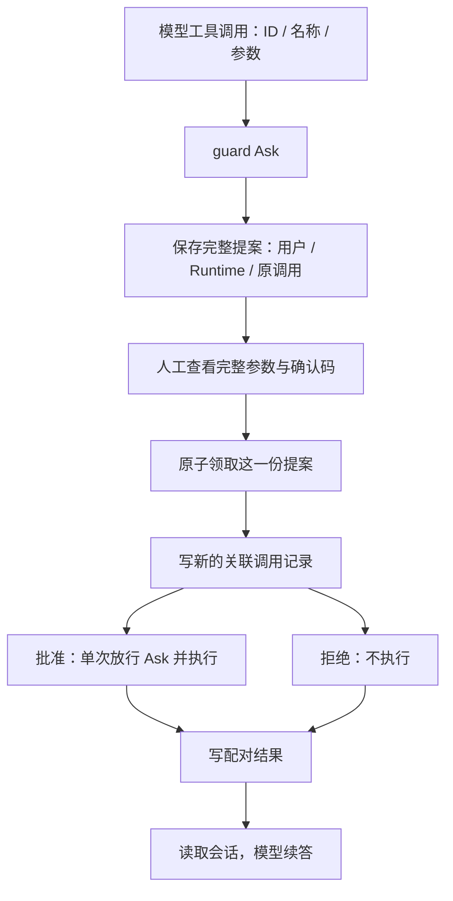
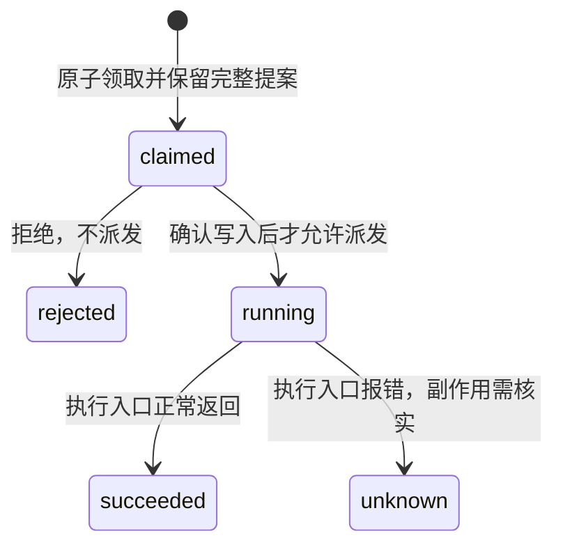

# 04：批准一个工具调用，究竟批准了什么？

F-2 第二、三批，2026-09-18。第二批用户 WSL 定向 6、全量 108 通过，第三批执行状态待运行；学习掌握状态待讨论。

## 调用链

## 三个关键取舍

1. **展示摘要不是执行参数。** `PendingAction.Param` 可以缩短，`Tool.Arguments` 必须完整。确认时展示完整参数，执行时使用存储快照，不让确认消息修改它。类比 Go：日志里打印的简写不能代替函数真正的参数结构体。

2. **批准只作用于这次调用。** Runtime 检查用户、实例和工具归属，再通过 `Pipeline.RunApproved` 放行 Ask；Deny、入参大小、超时和脱敏仍在。没有往 context 放可被子调用继承的“永久批准”标记，也不修改 MCP 信任名单。实例重建后旧提案拒绝执行，避免同名工具已被替换却沿用旧授权。

3. **“等待审批”和“实际执行结果”是不同事实。** 原调用已有挂起结果，不能再往同一个调用 ID 追加第二条 tool/result。这里用 `approval:<提案ID>` 建新调用对，并在新的审批输入中关联原调用。调用记录写不进去就不执行；结果写不进去就不让模型继续。这些边界不等于进程崩溃后恰好执行一次。

## 阅读与实验

沿 `agent/loop.go` → `agent/agent.go` 的 askWithStore → `approval/approval.go` → `harness/tool_approval.go` → `agent/runtime.go` 阅读。执行工具和拒绝工具走同一个结果回填路径，但只有批准分支调用实际工具。

查看 `test/e2e/tool_approval_test.go` 的两个写入故障：先预测哪一个工具计数为 0、哪一个为 1，再看模型请求次数为什么都不能增加。区别是“还没有执行”和“已经调用但结果未确认”，不能统一写成“失败后重试”。

当前测试不代表真实 MCP 传输已跑通；F-2 不能据代码存在就标完成。

## 领取之后进程退出，会留下什么？

第三批将“删掉待审批提案”和“保留 claimed 执行记录”放在同一 Redis 脚本。后续状态如下，查询命令为 `auth:status <提案ID>`：

Go 函数返回 error，不意味着它没产生副作用。例如先写远端文件，再因读取响应超时报错，文件可能已经写好。因此 unknown 不会自动重试。running 也可能是仍在执行，或者已经执行但没有保存终态；它不是“进程已死”的证明。

succeeded 与模型续答是两回事：工具返回成功后，会话日志仍可能写失败。前者保留执行事实，后者阻止继续请求模型。新测试的 result-write-error 就检查这个区别。读取 `approval/execution.go` 的状态约束，再读 `approval_state.go` 的收尾写入，以及 `tool_approval.go` 的派发顺序。

遇到 running/unknown，先按原提案检查目标系统的实际结果，不能仅因聊天没有成功回复就重新批准。当前只有状态查询，没有自动接管或人工修改终态接口；记录暂不自动清理，Redis 的持久性仍取决于部署配置。

## 真实协议与真实模型，分别证明什么？

第三批已由用户验证：定向 4、全量 112，0 跳过。第四批 `test/e2e/mcp_approval_test.go` 不再用一个 MCP 名字代替协议：它启动独立 stdio 子进程，通过 MCP SDK 握手、发现工具、调用远端。子进程把实际收到的参数写入临时文件，检查有没有提前执行、重复执行或参数截断。模型仍是假模型，用来稳定要求同一个工具调用；这能验框架协议链，不证明真实模型每次都选对工具。

本轮发现的错误很典型：`CallTool` 返回 `(result, nil)` 只表示协议请求成功，`result.IsError` 仍可能为 true。类比 Go HTTP 客户端：`Do` 没有 error，不代表业务返回成功。桥接器必须把这一层业务错误转成 Go error，才能让 guard、审批状态和模型回填沿同一条失败路径处理。第四批运行待 WSL 验证，用户理解仍待讨论。

## 运行归属：原调用与批准执行是两次运行

F-3 新增可选归属字段，旧日志照常读。假设运行 A 发出调用 C 并挂起提案 P：P.origin 指向 A；人工批准时新建运行 B，新调用 ID 为 approval:P，执行结果和续答事件属于 B。审计记录同时保存 P 与 P.origin，因此能从 B 追溯 A 中的原始调用 C。

user:<uid> 是现有单用户日志的兼容会话名，尚未支持一个用户创建多个会话；run_id 每轮不同。它们只是追溯标签，不能代替用户鉴权。子任务独立归属下一批接入，不能把父运行的标签当成已实现子任务日志隔离。
