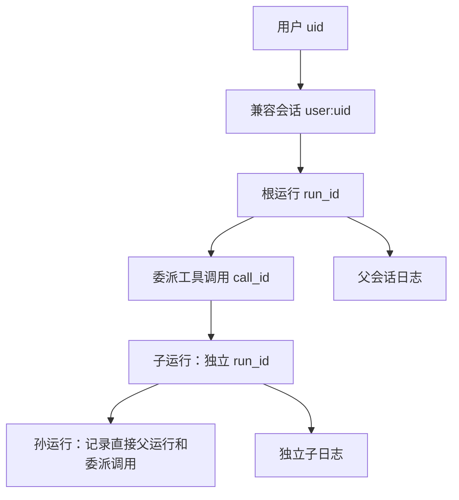

# 05：一次任务属于谁，取消到哪里？

F-3 框架实现收口，最后三项回归待 WSL。工程证据见 HARNESS-TODO；学习掌握情况待讨论。

## 归属关系

用户是身份，会话是历史归属，一次运行是一次执行。当前每用户只有一个兼容会话，Redis 原历史 key 不变；新运行 ID 每次生成。工具调用 ID 连接一次请求与结果。子日志保留 parent_run_id 和 parent_tool_call_id，因此能追到哪个父调用派出了这个任务，不能只记最顶层运行而丢失中间层。

## 取消和退出

旧 `/ws` 与 RPC 使用同一个 Harness，所以从旧聊天发起的任务可以由 RPC 查询和取消。用户身份由连接鉴权确定，取消还必须指定当前运行 ID，防止延迟请求误伤下一轮。

Go 的 cancel() 关闭 context.Done()，不会杀 goroutine。工具可能还在清理或根本不响应；因此发送取消后仍保留运行占用，直到入口实际返回。排队子任务收到取消后不能再构造模型。父取消自然传播到继承 context 的子任务，子结束记录用独立且有限的收尾时限保存中断状态。

## 为什么子审批暂时拒绝

有子日志不等于有子审批恢复。当前用户级待审批槽与审批后的续答属于主会话；若子防御工具写入该槽，人工确认无法正确回到那个子循环。因此通用 Ask 和内置防御均要求由主任务发起审批，直到以后实现子任务挂起、恢复与回填契约。

## 本阶段不保证什么

互斥只覆盖同一进程的同一个 Harness。不同实例、独立 resume 命令或多个服务进程没有共享运行锁。当前不提供多会话管理、子任务单独取消/自动恢复或自动审批接管；父子 usage 汇总、日志保留策略和 Redis 容灾另行建设。取消成功响应不是副作用已回滚的证明。

阅读入口：`run_control.go` → `appserver/appserver.go` / `handler/ws_handler.go` → `subagent/subagent.go` → `session/child.go`。对应收口测试为 `test/e2e/f3_boundary_test.go`。
