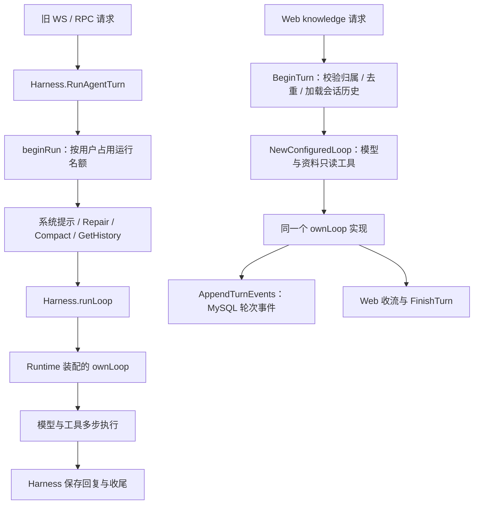

# 06：参考两个真实 Harness，理解我们的执行主干与下一步

日期：2026-09-21。

状态：源码对照与设计建议，尚未实施新的接口或迁移；用户理解待讨论确认。本文记录可核查的判断依据、取舍和推进顺序。工程状态以 HARNESS-TODO.md 为准。

## 1. 要解决的问题

我们已经有自研 Loop，也有历史、压缩、审批、恢复和运行控制；Web 工作台也能多步调用资料工具。现在需要弄清：这些能力如何组成一套可理解、可复用的执行系统？Web 为什么还没有接入完整 Harness？

我的判断是，当前最值得建设的地方是会话与执行能力的连接。继续增加检索功能不能解决这个问题；重写现有循环也没有充分依据。应先沿真实调用链理解职责，再确定一个必要的连接改动。

## 2. 参考范围和证据

只读本地源码，未 fetch，也未运行两个参考项目。本文不声称覆盖其全部实现或最新上游版本。

| 项目 | 本次参考版本 | 主要用途 |
|---|---|---|
| deepseek-harness | `b150a551b8d465e31e418e1b2eaf5e79bbb7d28e` | 观察 session、turn、step、模型和工具怎样连起来 |
| codex | `a8468330bb5f45e9f4d2ec630b01ea8c52908be3` | 观察会话入口、运行状态和每步依赖的寿命与归属 |
| Go-AI-Gateway | `d8e28bc` | 核对现有完整 Harness 与 Web 直连 Loop 的差异 |

以下路径以工作区根目录为起点，行号为本次阅读定位，后续以函数名为准。

| 证据位置 | 读到的行为 | 支持的判断 |
|---|---|---|
| `deepseek-harness/packages/core/agent-loop/src/agent.ts:246`，`turn()` | 记录 turn/step 边界，调用 preStep 与 step，保存结构化结束原因 | turn 包含多步执行，结束原因是运行事实 |
| 同文件 `:332`，`step()` | 使用 session.deriveMessages() 构造请求；无工具调用则完成，有工具则执行并决定是否继续 | 工具调用后的继续执行属于循环职责 |
| `deepseek-harness/packages/core/session/src/index.ts:425`、`:726` | Session 持有事件日志与投影，deriveMessages 返回模型消息快照 | 事件日志和模型输入需要区分 |
| `codex/codex-rs/app-server/src/request_processors/turn_processor.rs:478`，`turn_start_inner` | 按 thread_id 加载线程，再提交 start_or_steer_turn | 外部请求先定位会话，再交给会话运行入口 |
| `codex/codex-rs/core/src/session/session.rs:40` | Session 持有 thread_id、active_turn、input_queue、services | 会话级状态与当前轮次状态有明确归属 |
| `codex/codex-rs/core/src/session/turn.rs:153`、`:333` | run_turn 做准备并循环采样；捕获本步上下文，使提示、工具声明和执行共享视图 | 一步执行需要内部一致的依赖 |
| `codex/codex-rs/core/src/session/step_context.rs:18` | StepContext 关联 TurnContext，保存模型、权限、MCP binding、tool_router 等 | 会话、轮次、模型请求的状态寿命不同 |

源码证明这里存在这些结构与调用，不证明它们没有缺陷。尤其 dsh 的 session.append 不等于磁盘已经持久化；本次没有追踪全部 flush 和崩溃恢复路径，不能由 append 推导物理耐久性。

## 3. Harness 与 Loop：按职责理解，不按类名理解

Harness 是围绕模型循环的一组运行职责：依赖装配、历史准备、运行归属、权限控制、取消、持久化、恢复和收尾。它不要求全部代码都写进一个名叫 Harness 的结构体。

Loop 解决较窄的问题：给定消息、模型、工具和执行约束，重复调用模型；模型要工具就执行，把结果放入后续输入，直到完成、失败、取消或达到限制。

两者也不是严格互不相交的盒子。我们的 Loop 会写 step 和工具事件，dsh 的 Agent 直接写 Session；日志能力可以由外部提供，再由循环在正确时点调用。判断边界应看谁拥有状态、谁提供依赖、谁决定执行顺序。

类比 Go：HTTP handler、业务 service 和事务不是由文件夹名字划分职责。一个 service 可以调用注入的 Store，但不意味着它必须负责创建数据库连接。

## 4. 从一个例子分清 session、turn、step

假设用户在一个会话里问：“根据这份资料解释取消与退出有什么区别。”模型选择先搜索、再阅读、最后回答。下面是可能的执行，不是对真实模型行为的保证。

```text
会话 C：保存多轮交流及其运行记录
  turn T：处理这次用户输入
    step 1：模型请求 search_sources → 程序执行搜索 → 得到位置
    step 2：模型看到搜索结果，请求 read_source → 程序读取正文
    step 3：模型看到正文，生成回答，不再请求工具 → 本轮完成
  下一次输入：开始另一个 turn，继续属于会话 C
```

本项目中，一个正常 step 包含一次模型采样及其请求的工具执行，一步可以包含多个工具调用。底层网络重试不应直接等同于新的一步业务决策。不同实现对重试和内部子阶段的命名可能不同，不机械对应代码行数或 HTTP 请求次数。

| 身份 | 回答的问题 | 当前 Go 注意点 |
|---|---|---|
| user / owner | 谁拥有数据、谁有权访问 | 工具权限必须使用真实用户 |
| conversation / session | 这段历史属于哪次持续对话 | 同一用户可以有多个 Web 会话 |
| turn | 这次输入对应哪轮处理 | Web 有服务端生成的 turn_id |
| run | 哪次实际运行、取消或审批续答 | Harness 有独立 run_id；不能默认永远等于 turn |
| step | 本轮进行到哪次模型与工具交互 | 用于执行顺序、事件与故障定位 |

## 5. 三种数据视图不能混用

执行日志回答“发生过什么”：开始、工具调用、工具结果、错误、取消、结束等。

模型上下文回答“这一步让模型看到什么”：系统提示、选定历史、当前输入、需要继续处理的工具对等。它可能受投影、摘要和预算影响，不是整个日志的原样复制。

页面视图回答“给用户展示什么”：聊天气泡、状态、来源片段等。界面已经显示文字，并不能单独证明答案和结束状态已经保存。

dsh 的 deriveMessages 是日志/会话表面到模型消息的具体实现之一。我们的历史投影已有相关能力；但 Web 目前从已完成轮次构造问答历史，另存本轮执行事件，不能称作已经复用了完整 Harness 的恢复与压缩路径。

## 6. Go 当前确实存在两条执行路径



完整入口见 `Go-AI-Gateway/internal/harness/harness.go:392` 和 `:464`。`run_control.go:29` 的 active map 以 userID 为键，运行引用使用 LegacySessionID；历史接口也以 userID 传递。因此它目前仍有“一名用户对应一个兼容会话”的约束。

Web 入口见 `Go-AI-Gateway/internal/knowledge/chat.go:81`、`:145`。`conversation.go:126` 的 BeginTurn 已有会话归属、请求去重、并发控制和服务端历史；FinishTurn 保存结果，events.go 记录执行证据。

因此准确判断是：Web 复用了自研循环，也已实现部分运行外围职责；它还没有通过完整 Harness 入口共享现成的运行、压缩、恢复和审批链。不能称作“Web 没有 Agent”，也不能称作“Web 已完整接入 Harness”。

## 7. 为什么优先解决会话连接

如果直接把 Web 调用改成 RunAgentTurn(userID, content)，历史会重新落到用户级兼容会话，Web 原有的会话归属不再自然成立。同一个用户两个对话可能共享不应共享的历史或运行占用；数据库轮次状态与 Harness 状态也可能各自解释一次执行。

如果反过来把 conversationID 塞进 userID，虽然看似能分开存储，却会把会话标识当成授权身份，破坏工具和资料归属检查。当前 Web 注释已经明确要求向 Loop 传递真实 owner。

所以这里要解决的是契约：谁负责会话历史，谁负责接纳一次运行，谁保存最终状态，失败时由谁报告。单纯换函数名无法完成这个连接。

## 8. 借鉴什么，暂时不采用什么

| 参考做法 | Go 的取舍及原因 |
|---|---|
| dsh 的 session / turn / step 边界 | 用来讲清现有循环和事件顺序；保留已有 ownLoop，不因参考实现更复杂而重写 |
| dsh 的日志投影 | 明确事件、模型消息、页面视图各自用途；不直接照搬其存储格式或缓存实现 |
| Codex 的会话入口 | 建议让会话身份成为执行契约的一部分，用户身份继续用于权限检查 |
| Codex 的 StepContext | 借鉴“一步内模型看到的工具与执行使用的工具一致”；当前 LoopConfig 已从同一工具切片建立索引，无动态切换需求时不增加空的快照框架 |
| dsh 的 Cordis 全插件体系 | 暂不引入；Go 已有构造注入和明确接口，当前问题不需要插件容器解决 |
| Codex 的 steer、队列和复杂环境状态 | 暂不整体迁移；先保持现有忙拒绝、取消及会话契约，运行中插话有真实需求再设计 |

“统一 Harness”也不意味着所有应用都开放相同工具。资料工作台仍需绑定 owner/library 的最小工具集合，不能因复用 Runtime 就自动开放 shell、MCP 或写操作。

## 9. 下一步建议与尚未决定的部分

学习顺序：先读 dsh 的 turn/step，再读 Codex 的 Session/TurnContext/StepContext，最后追踪 Go 两条路径。每次只解决一个问题：依赖是谁创建的、状态属于谁、失败由谁收尾。

工程上，建议先设计并实现“真实用户 + 显式会话身份”的最小运行连接。但本轮只是记录建议，并未授权或实施接口改造；不要把此文当成已经选定的 API 签名。

实施前需要在现有代码上作出以下具体选择：

1. Web conversation 与 Harness session 怎样关联，兼容入口怎样保留旧会话；不能伪造 userID。
2. MySQL 会话记录和 Harness 历史由谁作为权威，如何避免双写产生两份不一致的历史；本轮不预先决定迁移到 Redis 或 MySQL。
3. BeginTurn 的数据库准入与 Harness 内存运行控制怎样协作；进程内锁不能替代已有的数据库并发检查。
4. Web turn_id 与 Harness run_id 怎样关联，取消、正常结束和失败分别由谁保存；取消请求不代表执行已退出。
5. 如何注入库范围工具、提示词和事件写入，复用已有 Runtime/LoopConfig 能力，并保证旧入口不回归。

候选验收反例：同用户两个会话历史不串；跨用户访问被拒；同一请求不重复执行；同会话并发行为明确；取消不能提前放开仍在执行的任务；核心事件或最终保存失败不能报告成功；资料工具无法越过库范围；旧 WS/RPC 的约定行为保持有效。

这些是后续连接主题的验收方向，不是本轮已通过的测试，也不意味着马上开放同用户多会话并行。并发政策需要单独确定。

## 10. 本轮边界与讨论入口

本轮只读参考源码并编写文档，没有修改 Go 代码、接口或数据结构，没有运行参考项目或新增测试。已有167项回归是先前用户WSL证据，不证明未来连接方案正确，也不表示本课已掌握。

第一个讨论题：同一个用户开了“学习 Go”和“学习数据库”两个会话，如果运行和历史仍只用 userID 寻址，会出现什么问题？先沿当前代码预测，再决定需要改哪条契约。
